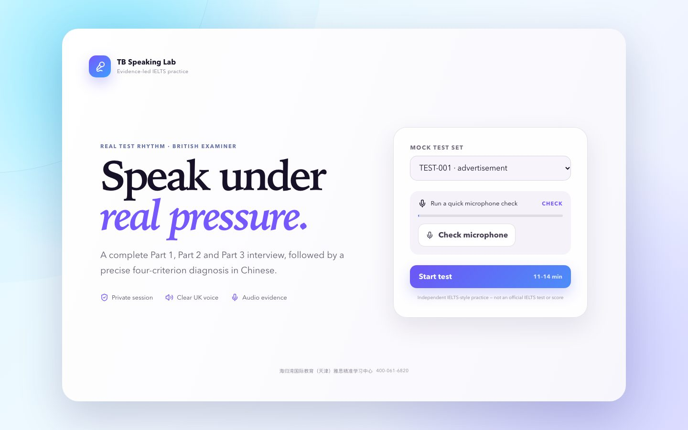

# IELTS Speaking Mock Test · 雅思口语模考

A full Part 1–3 speaking test with a British AI examiner and a four-criterion band report.

英国口音 AI 考官，完整 Part 1–3 模考，四项评分加中文诊断。

**Free · no sign-up · works on phones.** Part of [Free English Learning Tools](https://github.com/shelfom/free-english-learning-tools), 11 free websites for IELTS, Cambridge English and academic vocabulary.

**[▶ Open the site](https://ielts-speaking-mock.coze.site/)** (fastest in mainland China)

[](https://ielts-speaking-mock.coze.site/)

## What's inside

- 128 complete test sets, 11–14 minutes each, no sign-up
- British-voice examiner, real Part 2 cue card with 1-minute preparation
- Band estimate for Fluency, Vocabulary, Grammar and Pronunciation with Chinese feedback
- Calibrated on 8 official IELTS sample candidates: every estimate within ±0.5 band

See [PRODUCT_SPEC.md](PRODUCT_SPEC.md) and [SCORING_SYSTEM.md](SCORING_SYSTEM.md) for how scoring works.

## Run it locally

```bash
pnpm install
# set OPENROUTER_API_KEY in your environment
pnpm dev
```

## More free tools from the same collection

| Site | What you practise | Open |
|---|---|---|
| [IELTS Listening Paraphrase](https://github.com/shelfom/ielts-listening-paraphrase) | Hear the words IELTS actually tests, then catch their paraphrases by ear. | [Site](https://ielts-listening-para.coze.site/) · [Mirror](https://shelfom.github.io/ielts-listening-paraphrase/) |
| [IELTS Reading Paraphrase](https://github.com/shelfom/ielts-reading-paraphrase) | Match the words in the question to the words in the passage — the core IELTS Reading skill. | [Site](https://ielts-reading-para.coze.site/) · [Mirror](https://shelfom.github.io/ielts-reading-paraphrase/) |
| [IELTS Sentence Repair](https://github.com/shelfom/ielts-sentence-repair) | Fix the grammar and word mistakes that cost IELTS writers their band score. | [Site](https://ielts-repair.coze.site/) · [Mirror](https://shelfom.github.io/ielts-sentence-repair/) |
| [IELTS Writing Translation · Write It Back](https://github.com/shelfom/ielts-writing-translation) | Translate model essays back from Chinese into English, sentence by sentence, and compare. | [Site](https://ielts-writeback.coze.site/) · [Mirror](https://shelfom.github.io/ielts-writing-translation/) |
| [IELTS Writing · Band 6 to Band 8](https://github.com/shelfom/ielts-writing-band-6-to-8) | Rewrite a Band 6 sentence at Band 8, then compare it with a Band 8 version. | [Site](https://ielts6-8.coze.site/) · [Mirror](https://shelfom.github.io/ielts-writing-band-6-to-8/) |
| [IELTS Writing West](https://github.com/shelfom/ielts-writing-west) | Four AI coaches from *Journey to the West* diagnose your essay and guide your rewrite, one criterion at a time. | [Site](https://ielts-writing-west.coze.site/) |
| [AWL 570 Flashcards](https://github.com/shelfom/awl-570-flashcards) | All 570 headwords of the Academic Word List — the vocabulary of IELTS, TOEFL and university reading. | [Site](https://awl-flash.coze.site/) · [Mirror](https://shelfom.github.io/awl-570-flashcards/) |
| [Cambridge KET Flashcards](https://github.com/shelfom/cambridge-ket-flashcards) | Every word on the official A2 Key vocabulary list, each with a storybook picture and a British voice. | [Site](https://ket-flash.coze.site/) · [Mirror](https://shelfom.github.io/cambridge-ket-flashcards/) |
| [Cambridge PET Flashcards](https://github.com/shelfom/cambridge-pet-flashcards) | The B1 Preliminary words that KET doesn't cover, each with a picture, a voice and a simple example. | [Site](https://pet-flash.coze.site/) · [Mirror](https://shelfom.github.io/cambridge-pet-flashcards/) |
| [Cambridge FCE Flashcards](https://github.com/shelfom/cambridge-fce-flashcards) | The B2 First words beyond KET and PET, unit by unit, with pictures and a British voice. | [Site](https://fce-flash.coze.site/) · [Mirror](https://shelfom.github.io/cambridge-fce-flashcards/) |

Browse them all on one page: **https://shelfom.github.io/free-english-learning-tools/**

## Credits and license

Built by **Turtle Bay International Education (海归湾国际教育)**, an IELTS, TOEFL and Cambridge English school in Tianjin, China.

- Code: [MIT](LICENSE).
- Original learning content (illustrations, recordings, explanations, example sentences, model answers): free for non-commercial teaching and learning under [CC BY-NC 4.0](https://creativecommons.org/licenses/by-nc/4.0/).
- Topics are community-recalled exam topics, not official IELTS material.
- Unofficial practice material, not affiliated with or endorsed by Cambridge University Press & Assessment, the British Council or IDP. IELTS is their registered trademark. Rights holders can [open an issue](https://github.com/shelfom/ielts-speaking-mock/issues) and we will respond promptly.

If this helped you, please ⭐ star the repo so other learners can find it.
